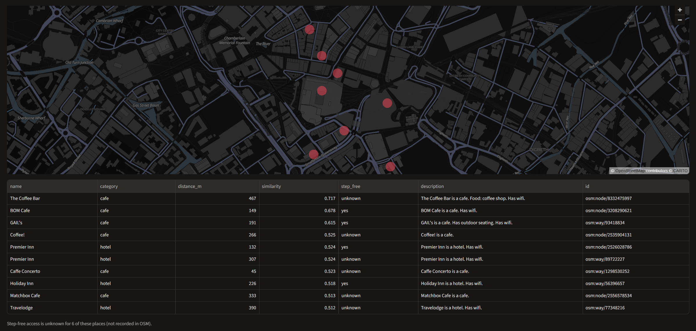
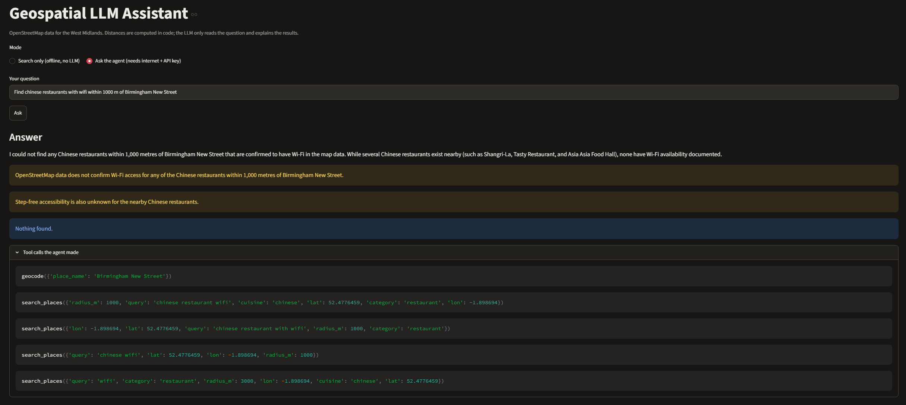

# Geospatial LLM Assistant

Finds nearby places from OpenStreetMap data by combining distance search with meaning-based search, so an LLM can answer local questions using real map facts.

> "Find cafes with wifi within 500 m of Birmingham New Street"

The key idea is that the maths is done in code, and the LLM only talks. The LLM (Gemini) reads the question, decides which tools to call, and explains the results. It cannot make up a place, because every place it mentions is checked against what the tools actually returned.



## What it can do

- Find places near a named spot (a station, a street, a shop) within a chosen distance.
- Filter by type (cafe, restaurant...), cuisine (indian, vegan...) and step-free access.
- Rank results by meaning, so "somewhere to work with wifi" can match "cafe. Has wifi."
- Say clearly when nothing matches, instead of showing something close-but-wrong.
- Run fully offline in "Search only" mode, with no LLM and no API key.

## How it works

1. **Extract the map data (`extract.py`):** Reads the West Midlands OpenStreetMap file and keeps 19,605 named places, such as cafes, restaurants, shops, libraries and stations. Step-free access is stored as yes, limited, no or unknown. If the map has no information, the record says "unknown", never "no".
2. **Measure distance (`geo.py`):** Uses the haversine formula, which is the straight-line distance on a sphere, to measure the distance between two place points. A quick box check removes far-away places first, so it stays fast.
3. **Search by relevance (`build_index.py`, `search.py`):** Each place gets a short text description built from its map tags, for example "BOM Cafe is a cafe. Has wifi.". A small embedding model (`all-MiniLM-L6-v2`) turns each description into numbers, and FAISS finds the closest matches. The search first keeps only places within the radius, then ranks them by meaning.
4. **Evaluate (`evaluate.py`, `label_helper.py`):** The distance part and the relevance part are tested separately.
5. **The agent (`agent.py`):** A Pydantic AI agent with two tools:
   - `geocode` turns a place name into coordinates.
   - `search_places` runs the search with filters.

   The answer has a fixed shape: a summary, place IDs and notes. A check rejects any answer that names a place the tools did not return.
6. **The demo (`app.py`):** A Streamlit web page with a map, a results table and both modes.

## Example answers from real runs

**Cafes with wifi within 500 m of Birmingham New Street.** The agent geocoded the station, then searched with `category=cafe`:

```
149 m  BOM Cafe                                  step-free: yes
191 m  GAIL's                                    step-free: yes
467 m  The Coffee Bar                            step-free: unknown
494 m  200 Degrees Coffee Shop & Barista School  step-free: yes
Note: Wifi speed and access rules are not in the data.
```

**Step-free vegan food within 800 m of New Street.** It used the `step_free_only` filter, and pointed out that these places have vegan *options*, not fully vegan menus.

**Indian restaurant within 500 m of the University of Birmingham.** It answered *"I could not find any"*. That is correct: the nearest Indian place is about 700 m away. Before the cuisine filter was added, plain meaning-based search returned 5 non-Indian places for this question.

**Chinese restaurants with wifi within 1 km of New Street.** It found Chinese restaurants nearby, but none has wifi recorded in the map. So it said so, instead of pretending.



## Results

| What I checked | Result |
| --- | --- |
| Is the radius search correct? (compared with checking every place, 200 test points) | 200 / 200 identical |
| Exact search time (FAISS Flat) | 1.73 ms per query |
| How often fast approximate search (HNSW) finds the same top 10 as exact search | 91.8% (0.04 ms per query) to 92.5% (0.18 ms per query) |
| Full search time, including turning the question into numbers | 41 ms typical (p50), 55 ms slow case (p95) |
| Are the top 5 results right? (3 questions I labelled by hand) | 80% of the top 5 were right (precision@5 0.80) |
| Share of all right answers that appear in the top 5 | 36% (recall@5 0.36), low because some questions have 40+ right answers |

## Run it

```
python -m venv .venv
.venv\Scripts\Activate.ps1  

pip install -r requirements.txt

# put the Geofabrik West Midlands .osm.pbf file in data/
python extract.py data/west-midlands-261108.osm.pbf
python build_index.py
python evaluate.py

# agent: put GOOGLE_API_KEY=... in a .env file
python agent.py "Find cafes with wifi within 500 m of Birmingham New Street"
streamlit run app.py
```

## Limitations

- The OpenStreetMap map data has gaps. Step-free access is unknown for 94% of places, and nothing records how quiet a place is.
- Relevance-based search always returns something. In search-only mode, "quiet cafe with wifi" with no category also returned hotels with wifi. Hard requirements (type, cuisine, step-free) must be filters, not just words in the query.
- Place-name lookup is simple. It matches names, so "University of Birmingham" lands on a campus building with that name, not the centre of the campus. Universities are not in the list of kept places yet.
- Buildings are reduced to the average of their corner points, and OSM relations (large multi-part areas) are skipped.
- The evaluation is small. The relevance labels are my own, on a small set of queries..
- The agent needs internet access and an API key. Search-only mode works offline.


## Data

Map data © OpenStreetMap contributors, available under the Open Database License (ODbL).
